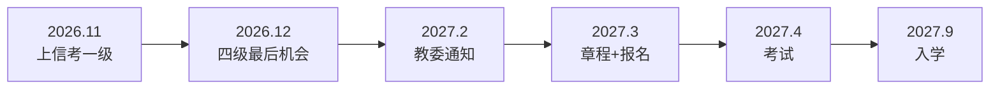

# 上海专升本攻略

> 一份写给上海专科生的**统招专升本（普通专升本）**避坑指南。
> 政策口径以 **2026 年官方文件**为基准，面向 **2027 届（2027 年 4 月考试）**考生，同时适用于之后各届的长期参考。

**适用对象**：上海高校在读专科生 ｜ **最后更新**：2026-11-16 ｜ **文档性质**：民间整理，非官方发布

> [!WARNING]
> 本文所有时间、科目、分数线都可能随年份调整。**最终以三份文件为准**：上海市教委年度《专升本考试招生工作的通知》、目标院校《招生章程》、《上海招考热线》报名系统提示。本文的价值在于帮你把这三份文件读懂、读快、不踩坑。

---

## 目录

- [零、先记五条铁律](#零先记五条铁律)
- [一、上海专升本是什么](#一上海专升本是什么)
- [二、报考资格](#二报考资格)
- [三、时间轴](#三时间轴)
- [四、院校与专业](#四院校与专业)
- [五、考试科目与分数线](#五考试科目与分数线)
- [六、报名操作指南](#六报名操作指南)
- [七、录取规则](#七录取规则)
- [八、退役士兵专项](#八退役士兵专项)
- [九、备考路线图](#九备考路线图)
- [十、常见误区](#十常见误区)
- [十一、常见问题](#十一常见问题)
- [十二、官方信息源](#十二官方信息源)
- [十三、贡献与许可](#十三贡献与许可)

---

## 零、先记五条铁律

| # | 铁律 | 说明 |
|---|------|------|
| 1 | **一辈子只有一次** | 只招应届专科毕业生。已被专升本录取过的（**包括录取后不报到**），终身不得再报 |
| 2 | **只能报 1 所院校** | 官方明确"限报一所院校"；多数院校只允许填 **1 个专业志愿**，没有平行志愿，没有第二志愿 |
| 3 | **四级 425 是门槛，不是加分项** | 报名系统里就要卡这一条。没过 = 没有报名资格，不是"考完再补" |
| 4 | **计算机证书是第二道门槛** | 上信考一级 / 全国计算机一级 / 参加校考，三条路必须走通一条 |
| 5 | **节奏只有一个月** | 3 月中旬报名 → 4 月中旬考试。等章程出来再复习，必来不及 |

> 这五条决定了上海专升本的底层逻辑：**它不是"考试难"，而是"决策难"**。选错一所学校、漏掉一张证书，努力一年直接归零。

---

## 一、上海专升本是什么

### 1.1 一句话定义

上海市普通高校**专升本考试招生**（俗称"统招专升本"、"全日制专升本"、"3+2"），是上海市教委组织的、面向**应届全日制专科毕业生**的升学考试。录取后进入本科院校**全日制就读 2 年**，毕业发**全日制本科毕业证**（注明"专科起点升本科"）和学士学位证。

### 1.2 和另外几种"专升本"的区别

| 类型 | 全称 | 学历性质 | 报考对象 | 学制 | 难度 |
|------|------|----------|----------|------|------|
| **统招专升本**（本文） | 普通高校专升本考试招生 | **全日制本科**（第一学历本科） | 应届专科生 | 2 年 | 中 |
| 自考专升本 | 高等教育自学考试 | 非全日制 | 不限 | 不限 | 科目多、周期长 |
| 成考专升本 | 成人高考 | 非全日制 | 需专科毕业证 | 2.5–3 年 | 低 |
| 国开专升本 | 国家开放大学 | 非全日制 | 不限 | 2.5 年 | 低 |

**关键差别**：只有统招专升本拿到的是**全日制**学历，在考公、考编、考研、上海落户积分、校招简历筛选中，与四年制本科同等对待。其余三种是成人继续教育，社会认可度不同。

### 1.3 上海模式的特殊之处

全国多数省份的专升本是**全省统考**（统一命题、统一科目、平行志愿），上海恰恰相反：

- **院校自主招考**：命题、组织考试、阅卷、划定分数线、录取，全部由招生院校自己负责
- **考试科目各校不同**：有的考 1 门、有的考 3 门，满分从 100 分到 300 分都有
- **没有平行志愿**：一校一专业，孤注一掷
- **报考门槛全国最硬**：英语四级 425 + 计算机证书，很多省份没有这两条

所以上海专升本的难点集中在**信息差**和**择校**，而不是"卷面难度"。反过来说，只要选对目标、证书齐备，专业课备考 4–6 个月是够用的。

---

## 二、报考资格

### 2.1 三类可以报考的人

| 人群 | 具体条件 | 备注 |
|------|----------|------|
| **① 普通应届生** | 上海高校 2027 届专科（含高职）毕业生；**或被外地高校录取的 2027 届专科上海生源毕业生** | 最常见。外地读书的上海户籍同学同样可以回沪报考 |
| **② 基层服务项目人员** | 参加"三支一扶"等基层项目，**服务期满且考核合格后 2 年内**，无工作经历 | 可享受一次应届生待遇 |
| **③ 退役士兵** | 专科应届毕业当年在**沪**应征入伍并于当年/次年退伍；或在校期间（含高校新生）在沪入伍、退役后复学的应届毕业生 | 免四级、免计算机，单独通道 |

### 2.2 硬性条件（缺一不可）

**英语四级**

- 大学英语四级考试成绩 **≥ 425 分**（官方原文："须大学英语四级考试成绩达 425 分及以上"）
- 小语种考生作为个案，由报考学校向市教委申请
- **艺术类专业**的外语要求由招生院校自主确定（部分艺术院校不要求四级，报名前必须逐校确认）

**计算机证书**

官方原文：*"各招生院校原则上应要求考生持有上海市高等学校信息技术水平考试证书，对没有证书的考生应组织与该考试大纲同等要求的考试，并在招生章程中明确告知。"*

翻译成人话，三条路任选其一：

| 路径 | 说明 | 时间成本 |
|------|------|----------|
| 上海市高等学校信息技术水平考试（上信考）一级 | 原"上海市计算机等级考试"，**每年 11 月**考一次，9 月中下旬报名，免费，电子证书 | 最稳，但要提前一年规划 |
| 全国计算机等级考试（NCRE）一级 | 多数院校认可 | 每年 3 月 / 9 月 |
| 参加报考院校组织的**计算机校考** | 没有证书时走这条路，考纲与上信考一级同等要求，**不合格直接失去考试资格** | 临时抱佛脚，有风险 |

> [!IMPORTANT]
> 上信考**一年只有一次（11 月）**，报名在 9 月中下旬，错过就得等一年。2026 年的考试是 11 月 14–15 日（一级），成绩 12 月下旬公布。
> 如果你是 2027 届，**现在（2026 年 11 月）已经考完或正在考**；没报上名的话，只剩 NCRE 或校考两条路。

部分院校对上信考一级的要求更严格（据公开整理，华东政法、上海海事、上海商学院等曾**只认上信考一级**，不认全国计算机等级证书）。这类学校必须逐字读章程，不能想当然。

### 2.3 不能报考的情况

- ❌ **往届生**（已经毕业的专科生，无论几年）
- ❌ 已被上海专升本录取过的考生，**含录取后未报到**
- ❌ 非全日制专科（自考、成考、网教、国开专科）
- ❌ 本科在读（不能"二次升本"）
- ❌ 专科在读但非应届（大一大二不能提前考）

### 2.4 免试 / 保送通道

在世界技能组织主办的**世界技能大赛**中获奖的专科毕业生，可按教育部规定向招生院校申请**保送至相应本科专业**，免技能考核，但**仍须网上报名并填报志愿**。

---

## 三、时间轴

### 3.1 以 2026 年为基准的完整节奏

| 时间 | 事项 | 说明 |
|------|------|------|
| 前一年 9 月中下旬 | 上信考报名 | 错过等一年 |
| 前一年 11 月中旬 | 上信考一级考试 | 2026 年为 11 月 14–15 日 |
| 前一年 12 月中下旬 | 四级考试（最后一次有效机会） | 成绩次年 2 月底出，3 月报名时刚好能用 |
| 1 月底–2 月初 | **市教委发布年度通知** | 2026 年为 2 月 9 日发布（沪教委学〔2026〕11 号） |
| 3 月上中旬 | **各校发布招生章程** | 2026 年立信为 3 月 13 日 |
| **3 月 17–18 日** | **网上报名 + 填报志愿** | 17 日 9:00–21:00，18 日 9:00–12:00，**只有一天半** |
| 3 月 29–30 日 | 缴费 | 29 日 9:00–22:00，30 日 9:00–15:00。逾期视为放弃 |
| 4 月初 | 计算机校考（无证书考生） | 2026 年立信为 4 月 8 日下午 |
| **4 月 12 日（周日）** | **统一考试日** | 上午 9:00–11:00，下午 13:00–15:00 |
| 4 月下旬–5 月 | 成绩公布、录取、公示 | 各校自行安排 |
| 6 月 | 专科毕业 | 报到时未取得毕业证 = 取消资格 |
| 9 月 | 本科入学 | 学制 2 年 |

### 3.2 2027 届倒计时（今天是 2026 年 11 月 16 日）

| 现在到考试 | 你该做的事 |
|------------|------------|
| 2026 年 11 月 | 确认上信考是否已过；没过立刻查 NCRE 3 月考位 或 目标院校校考形式 |
| 2026 年 12 月 | **如果四级还没到 425，这是最后一次有效机会**（2027 年 6 月那场成绩出来时报名已结束） |
| 2027 年 1–2 月 | 寒假是专业课唯一的整块时间，必须完成第一轮 |
| 2027 年 3 月 | 章程发布 → 核对科目/专业对口/证书要求 → 报名 → 缴费 |
| 2027 年 4 月 | 真题模拟 + 冲刺 |

> [!TIP]
> **2027 年考试日期预测**：2026 年为 4 月 12 日（周日）。按"4 月中旬的周日"规律，2027 年大概率在 **4 月 11 日**前后，但这是推测，不是官方结论。

---

## 四、院校与专业

### 4.1 23 所招生院校（2026 年）

2026 年共 23 所本科院校招生：**17 所公办 + 6 所民办**。其中上海中医药大学、上海体育大学、上海戏剧学院**只招高本贯通学生**，普通应届生报不了。

| 院校 | 性质 | 应届计划 | 高本贯通 | 退役士兵 |
|------|------|---------:|---------:|---------:|
| 上海理工大学 | 公办 | 85 | — | 75 |
| 上海海事大学 | 公办 | 10 | — | 75 |
| 华东政法大学 | 公办 | 5 | — | 75 |
| 上海电力大学 | 公办 | 7 | — | 75 |
| 上海师范大学 | 公办 | 100 | 230 | 75 |
| 上海对外经贸大学 | 公办 | 3 | — | 75 |
| 上海工程技术大学 | 公办 | 80 | 50 | 75 |
| 上海应用技术大学 | 公办 | 22 | 66 | 75 |
| 上海立信会计金融学院 | 公办 | 72 | 63 | 75 |
| 上海第二工业大学 | 公办 | 135 | 34 | 75 |
| 上海电机学院 | 公办 | 87 | 30 | 75 |
| 上海商学院 | 公办 | 26 | 28 | 75 |
| 上海政法学院 | 公办 | 5 | 30 | 75 |
| 上海健康医学院 | 公办 | 141 | — | 75 |
| 上海中医药大学 | 公办 | — | 32 | — |
| 上海体育大学 | 公办 | — | 60 | — |
| 上海戏剧学院 | 公办 | — | 17 | — |
| 上海杉达学院 | 民办 | 943 | 180 | 75 |
| 上海建桥学院 | 民办 | 1968 | 71 | 75 |
| 上海立达学院 | 民办 | 1580 | 35 | 75 |
| 上海中侨职业技术大学 | 民办 | 1137 | 63 | 75 |
| 上外贤达经济人文学院 | 民办 | 692 | 88 | 75 |
| 上海师范大学天华学院 | 民办 | 885 | 234 | 75 |
| **合计** | | **7983** | **1311** | **1500** |

**2026 年总计划 10795 人**（应届 7983 + 高本贯通 1311 + 退役士兵 1500），比 2025 年增加 1210 人。

### 4.2 一个必须知道的结构性事实

把上面的数字加一遍：

- 公办院校应届计划合计 **778 人**
- 民办院校应届计划合计 **7205 人**

也就是说，**90% 的普通应届名额在民办**。想读公办，你面对的是全市不到 800 个位置，其中还有华政（5 人）、对外经贸（3 人）、政法（5 人）、电力（7 人）这种"个位数招生"的极窄门。

这个结构直接决定了择校策略：

| | 公办 | 民办 |
|---|---|---|
| 应届计划 | 778 人 | 7205 人 |
| 竞争 | 极卷，热门专业一年涨 80 分 | 相对温和，部分专业招不满 |
| 学费（每年） | 6500–7400 元（艺术类 13000 元） | 29800–59800 元 |
| 两年总花费 | 约 1.5 万–3 万元 | 普遍 7 万–14 万元 |
| 上课方式 | 多为**插班**（跟大三一起上课） | 多为独立组班 |
| 社会认可 | 最高 | 全日制本科，同样有效 |

> 公办不是"更好"，是"更便宜 + 更卷"。如果目标是考研、考公、落户，民办同样是全日制本科学历，性价比取决于家庭预算。

### 4.3 选校四步法

1. **卡专业对口**：绝大多数院校要求本科专业与专科专业相同或相近。部分院校（如立信金融学、会计学、日语）**明确不限专业**，这类专业是跨考的唯一窗口
2. **卡证书要求**：有没有院校只要上信考一级？有没有院校要求四级更高分（如电机软件工程 2026 年录取者四级 452 分）？
3. **卡考试科目**：你能不能考高数？不能就别碰考高数的专业，哪怕它招 135 人
4. **卡分数**：把近两年分数线列出来，按"我能考到的分"倒推院校，而不是按"名校情结"正推

---

## 五、考试科目与分数线

### 5.1 考试的基本形态

- **无全市统考**，全部由招生院校自主命题、自主阅卷
- 科目数量：**1–3 门**，每门满分通常 100 分，总分 100 / 120 / 150 / 200 / 300 不等
- 考试时长：多为上午一场、下午一场，每场 2 小时
- 考试地点：在报考院校校区内

**这意味着分数线不能跨校比较**——同样是"170 分"，在满分 200 的学校是高分，在满分 300 的学校刚过线。

### 5.2 常见科目组合

| 专业大类 | 常见科目组合 | 代表院校 |
|----------|--------------|----------|
| 经管类 | 高等数学 + 管理学 / 经济学 | 上海海事、上海立信、上海第二工业大学 |
| 财经类 | 高等数学 + 会计专业综合 / 金融学 | 上海立信会计金融学院 |
| 计算机类 | C 语言 + 数据结构 / 数据库 / 计算机原理 | 上海第二工业大学、上海电机学院、上海商学院 |
| 机械电气类 | 机械设计基础 + 机械制图 / 电工电子技术 | 上海电机学院、上海工程技术大学 |
| 文史类 | 大学语文 + 古代文学史 / 写作 | 上海政法学院、上海第二工业大学 |
| 外语类 | 综合英语 / 综合日语（含听力） | 上海立信、上外贤达 |
| 医学类 | 护理综合 / 有机化学 + 药理学 / 解剖生理学 | 上海健康医学院、上海杉达 |
| 艺术类 | 创意素描 / 快题设计 / 命题设计（多含手绘或机考） | 上海应用技术大学、上师天华、上海建桥 |
| 教育类 | 学前教育知识与能力 / 小学教育知识与能力 | 上海建桥、上师天华 |
| 工科综合 | 高等数学 + 专业课 | 上海理工大学、上海电力大学 |

### 5.3 2026 年录取分数线（样例）

> 以下数据来自网络公开整理，**非官方发布**，仅用于感受量级。请务必以各校官网公示为准。
> "满分"为该专业所有科目总分，各校不同，不可横比。

**公办院校**

| 院校 | 专业 | 考试科目 | 计划 | 满分 | 2026 分数线 |
|------|------|----------|-----:|-----:|-----------:|
| 华东政法大学 | 法学 | 法律基础 + 大学英语 | 10 | 200 | 163 |
| 上海对外经贸大学 | 经济学 | 高数基础 + 英语 + 西方经济学 | 3 | 300 | 246 |
| 上海海事大学 | 工商管理 | 高等数学 + 管理学 | 10 | 300 | 258 |
| 上海师范大学 | 旅游管理 | 旅游学概论 + 管理学原理 | 65 | 300 | 229.5 |
| 上海理工大学 | 包装工程 | 高等数学 + 印刷综合 | 50 | 200 | 135 |
| 上海立信 | 会计学 | 高等数学 + 会计专业综合 | 28 | 200 | 169 |
| 上海第二工业大学 | 计算机科学与技术 | 高数 + 计算机原理 + 数据结构 | 12 | 300 | 265 |
| 上海第二工业大学 | 电子信息工程 | 高数 + 电工技术 + 电子技术 | 6 | 300 | 238 |
| 上海电机学院 | 软件工程 | C 语言 + 数据结构 | 5 | 200 | 175.5 |
| 上海商学院 | 计算机科学与技术 | C 语言 + 数据库 | 8 | 200 | 177 |
| 上海健康医学院 | 护理学 | 护理综合（一）+（二） | 98 | 200 | 138.5 |
| 上海应用技术大学 | 化学工程与工艺 | 无机化学 | 2 | 100 | 47 |
| 上海工程技术大学 | 机械工程 | 机械设计基础 | 10 | 100 | 75 |

**民办院校**

| 院校 | 专业 | 考试科目 | 计划 | 满分 | 2026 分数线 |
|------|------|----------|-----:|-----:|-----------:|
| 上海建桥学院 | 计算机科学与技术 | C 语言 | 120 | 100 | 43 |
| 上海建桥学院 | 英语 | 综合英语 | 200 | 100 | 47.5 |
| 上海杉达学院 | 计算机科学与技术 | C 语言 | 30 | 120 | 84 |
| 上师天华学院 | 学前教育 | 学前教育专业知识与能力 | 55 | 150 | 62 |
| 上海立达学院 | 汉语言文学 | 中国古代文学 | 100 | 100 | 60 |
| 上海中侨职业技术大学 | 数字媒体技术 | Python | 64 | 100 | 37 |
| 上外贤达 | 英语 | 语言能力测试（英语） | 32 | 150 | 105 |

### 5.4 从分数里能读出什么

1. **公办的"低分专业"往往是冷门或高门槛**：应用技术大学化学工程 47 分（满分 100），是因为考无机化学，敢报的人本来就少
2. **一年涨 80 分是真实存在的**：二工大电子信息工程 2025 年 158 分 → 2026 年 238 分（满分 300）。热门专业没有"稳"
3. **民办分数低 ≠ 好考**：建桥 C 语言 43 分（满分 100），看着低，但只招 120 人，报考基数大，且要过四级门槛
4. **满分不同，绝对分数没有意义**：看的是"得分率"和"位次"

---

## 六、报名操作指南

### 6.1 报名入口

**上海招考热线**：<https://www.shmeea.edu.cn>

> [!CAUTION]
> 普通考生和退役士兵**从不同入口登录**。走错入口会导致志愿填报无效，官方文件专门强调了这一点。

### 6.2 材料清单

| 材料 | 要求 | 获取方式 |
|------|------|----------|
| 证件照 | 近期正面免冠彩色头像 | 自备 |
| 身份证 | 正反面 | 扫描/拍照 |
| 学籍在线验证报告 | 在校生提供 | 学信网 → 学籍查询 → 下载 |
| 学历电子注册备案表 | 已毕业者提供（基层项目人员） | 学信网 → 学历查询 |
| 大学英语四级成绩单 | **外地高校录取的上海生源**必须上传 | 四六级官网 |
| 基层服务项目证明 | 基层项目人员 | 主管部门出具 |
| 退役军人证 | 退役士兵 | — |
| 三等功及以上奖励证明 | 申请加分的退役士兵 | — |
| 退役士兵资格审查表 | 需就读院校审核签字盖章 | 官方附件下载 |
| 世界技能大赛获奖证书 | 申请保送者 | — |

> 学信网报告建议**提前一周下载**，报名当天系统拥堵，临时申请容易卡住。

### 6.3 缴费标准

- 报名费 **14 元/人**
- 考试费 **26 元/科**

| 报考科目数 | 费用 |
|-----------|-----:|
| 1 门 | 40 元 |
| 2 门 | 66 元 |
| 3 门 | 92 元 |
| 3 门 + 计算机校考 | 118 元 |

**逾期未缴费 = 放弃报考**，且弃考不退费。

### 6.4 时间窗口有多窄

- 报名窗口：**3 月 17 日 9:00 起，到 3 月 18 日 12:00 结束**，共 27 小时
- 缴费窗口：3 月 29–30 日，共约 30 小时

**报名只有一天半**。这不是"大概三月中"，是精确到小时。每年都有人因为记成"三月一整月"而错过。

### 6.5 提交之后

- 志愿提交后**无法修改**，无法新增
- 缴费成功后，关注报名系统通知，自行打印准考证
- 有计算机校考的院校，校考时间通常在 4 月初，需另行查看院校公告

---

## 七、录取规则

### 7.1 谁说了算

各校按**已向社会公布的招生章程**录取，市教委只负责核准备案和学籍注册。这意味着：

- 录取规则写在章程里，章程具有约束力
- 未按章程录取的考生**不予注册学籍**，学历证书也不予注册
- 学校法定代表人要对章程真实性负责

### 7.2 通用录取逻辑

1. 按专业（或招考模块）分别排序
2. 总分从高到低，录满为止
3. 同分时按章程规定的科目顺序比较

**同分规则示例（上海立信 2026）**：

- 金融学：优先《金融学》分数高者
- 会计学：优先《会计专业综合基础》分数高者
- 数据科学与大数据技术：优先《Python 程序设计基础》分数高者
- 日语：先比听力，再比 N2，再比六级/四级

同分规则意味着：**不要平均用力**，把分数堆到章程规定的那一门上。

### 7.3 调剂

- 调剂**只在同一招考模块内**进行，不能跨模块
- 模块之间考试科目不同，无法调剂（立信明确"不能跨模块进行专业调剂"）
- 部分院校在某模块生源不足时，会把缺额计划调到其他模块自主录取
- 报名时通常有"是否服从调剂"选项，**建议勾选**——前提是你接受该校该模块下的所有专业

### 7.4 录取之后

- 学校会复核所有上传材料的**原件**，审查合格才注册学籍
- 报到时**未取得专科毕业证**，录取作废，且**不能保留入学资格**
- 新生入学后有体格复查和高职高专毕业审查
- 学费按当年度同年级同专业标准执行

> [!WARNING]
> 被录取后不去报到，等于把这个"一次性机会"用掉了。想"先上岸再复读"的路，在上海不存在。

---

## 八、退役士兵专项

这是上海专升本里**最特殊也最划算**的通道。

### 8.1 谁能用

两类人：

1. 专科**应届毕业当年**在沪应征入伍，并于当年或次年退伍的退役士兵
2. 在校期间（含高校新生）在沪应征入伍，退役后复学的应届专科毕业生

**必须是"在沪"入伍**。外地入伍的上海生源不适用这一条。

### 8.2 政策红利

| 项目 | 普通考生 | 退役士兵 |
|------|----------|----------|
| 英语四级 | 必须 ≥425 | **不要求** |
| 计算机证书 | 必须持有 | **不要求** |
| 文化课考试 | 参加院校自主命题考试 | **免文化课考试** |
| 志愿数量 | 限报 1 所院校 | **所有院校排序填报**，每校至少 1 个专业 |
| 加分 | — | 个人三等功及以上 **+10 分** |
| 计划 | 应届计划 | **单独 1500 人计划**（2026 年） |

### 8.3 要考什么

不考文化课，但要参加全市统一的**适应能力分流测试**：

- 组织方：委托**上海杉达学院**统一组织
- 时间：与普通考生**同日、不同卷**（2026 年为 4 月 12 日）
- 满分：**200 分**
- 内容：**军事常识、时事政治、文学常识、思维逻辑**四个方面
- 同分比较顺序：军事常识 → 时事政治 → 文学常识
- 准考证：4 月 5–11 日登录"上海招考热线"下载打印

### 8.4 志愿怎么填

退役士兵必须对**所有招生院校进行排序填报**，每所院校**至少填 1 个专业志愿**，缺报无法提交。可以填 2 个专业。这是"平行志愿 + 分数优先"的投档方式，容错率远高于普通考生。

> 这条政策的隐含信息：退役士兵的 1500 个计划在招生计划表中**单独列示**，与普通应届计划分开下达。计划多、门槛低、可填多校，是上海专升本里确定性最高的路径。如果条件允许且时间合适，值得认真权衡。

---

## 九、备考路线图

### 9.1 2027 届：现在只剩 5 个月

| 阶段 | 时间 | 任务 |
|------|------|------|
| **收尾期** | 2026.11–12 | 确认证书（四级/计算机）；锁定目标院校 2–3 所；收集近 3 年真题 |
| **奠基期** | 2027.1–2（寒假） | 专业课第一轮，通读指定教材 + 整理框架。这是唯一连续的整块时间 |
| **定向期** | 2027.3 | 章程发布 → 最终定校定专业 → 报名缴费 → 第二轮强化 + 真题 |
| **冲刺期** | 2027.4 | 全真模拟（按考试时间），错题复盘，背诵类科目收口 |

### 9.2 大一大二：24 个月长线

| 阶段 | 时间 | 任务 |
|------|------|------|
| 大一 | 全年 | 英语打底（四级词汇 + 听力），保持 GPA（部分院校看专科成绩） |
| 大二上 | 9–12 月 | 报考四级，争取一次过 425 |
| 大二下 | 3–6 月 | 四级刷分（分越高越有底气）；开始接触目标院校专业课 |
| 大二暑假 | 7–8 月 | 确定 3 所目标院校，买齐教材，启动第一轮 |
| 大三上 | 9–11 月 | **上信考一级**（9 月报名、11 月考试）；专业课第一轮收尾 |
| 大三下 | 12–4 月 | 按 9.1 的节奏走 |

### 9.3 各科怎么学

**高等数学**

- 上海各校高数难度普遍低于考研数三，接近期末考水平，但**范围由院校自定**
- 先拿到目标院校的**考试大纲**，按大纲划范围，不要盲目刷考研题
- 核心：极限、导数及应用、积分、常微分方程、线性代数基础（部分院校）
- 三轮法：教材例题 → 章节习题 → 真题限时

**英语**

- 四级 425 只是门票，校考英语难度通常**高于四级、低于六级**
- 词汇是硬通货：四级 4500 词 + 六级高频 1000 词
- 阅读理解占分最高，每天 2 篇精读，比背单词书有效
- 部分院校考听力（如综合日语含听力），提前确认题型

**专业课**

- **真题是最高优先级**，多数院校题型重复率高
- 教材以章程/大纲指定版本为准，不同版本章节差异很大
- 建立"名词解释 → 简答 → 论述"的分层笔记，按题型背

**计算机（C 语言 / Python / 数据库）**

- 上海专升本计算机类考试偏基础语法 + 程序阅读，机考院校还有上机题
- C 语言重点：数组、指针、函数、结构体、文件
- 数据库重点：SQL 语句、范式、ER 图
- 刷题平台：PTA、LeetCode 简单题（练手感即可）

**艺术类手绘 / 快题**

- 评分看**构图、造型、完成度**，不看创意天马行空
- 必须按目标院校的**历年真题范式**练，风格要对味
- 考前一个月保持每天 1 张完整稿，控制时间

### 9.4 真题从哪来

1. 目标院校**招生信息网 / 教务处**（部分院校公开历年真题或样卷）
2. 院校官方**考试大纲 + 参考书目**（最重要，几乎决定命题范围）
3. 上海市教委"专升本与插班生"专栏（政策文件、章程汇总）
4. 学长学姐、考生社群（注意甄别，市面上的"真题"大量是回忆版）

---

## 十、常见误区

| # | 误区 | 真相 |
|---|------|------|
| 1 | "上海专升本很简单" | 公办热门专业一年涨 80 分，计算机类 300 分满分要考 265 |
| 2 | "民办随便上" | 民办占 90% 名额但不等于零门槛：四级必须过，且部分专业分数也在涨 |
| 3 | "四级没过，考上再补" | 报名系统直接卡 425，没有补的余地 |
| 4 | "等章程出来再准备" | 章程 3 月中旬出，考试 4 月中旬，只有 30 天 |
| 5 | "可以报几所学校保底" | 只能报 1 所，没有平行志愿 |
| 6 | "考不上明年再来" | 只招应届，且录取过（含不报到）终身禁考 |
| 7 | "计算机证书不重要" | 没证书要参加校考，校考不过**直接失去考试资格** |
| 8 | "跨专业随便跨" | 多数院校限专业对口，只有少数专业明确不限 |
| 9 | "专升本文凭没用" | 全日制本科，考研/考公/落户与四年制本科同等待遇 |
| 10 | "学费都差不多" | 公办 6500–7400/年，民办 3 万–6 万/年，两年差 10 万 |
| 11 | "报名时间是三月一整月" | 实际是 3 月 17 日 9:00 到 18 日 12:00，27 小时 |
| 12 | "分数线和别的省一样能横比" | 各校满分 100–300 不等，只能看得分率和位次 |

---

## 十一、常见问题

**Q1：我是外地专科的上海户籍学生，能回上海考吗？**
能。属于"被外地高校录取的 2027 届专科上海生源毕业生"，报名时须额外上传四级成绩单。

**Q2：四级 425 分是取最高一次成绩吗？**
是。多次考试取最高分，只要在报名截止前有 ≥425 的记录即可。

**Q3：日语/德语等小语种考生怎么办？**
小语种作为个案，由报考学校向市教委申请。部分院校（如立信日语专业）接受日语 N2 替代四级。

**Q4：艺术类真的不要四级吗？**
"艺术类专业考生的外语要求由招生院校自主确定"。有的不要，有的要，必须看章程，不要听传言。

**Q5：专科专业和目标本科专业不对口，一点机会都没有吗？**
取决于院校。立信金融学、会计学、日语明确"不作专业对口限制"；数据科学则限 5102 计算机类。**先查章程的"选拔对象"和"录取规则"，不要先问学长。**

**Q6：高本贯通和专升本是一回事吗？**
不是。高本贯通是中考后"中职—高职—本科"一体化培养的转段通道，只限合作院校特定专业的学生，2026 年有 1311 个计划。普通专科生走的是"专升本"。

**Q7：录取后可以不去吗？**
可以不去，但**这个考生身份就永久用掉了**，且不能保留入学资格。不去等于放弃唯一一次全日制升本机会。

**Q8：专升本可以跨省吗？**
不能。上海专升本只招上海高校应届生 + 外地高校的上海生源应届生，报考院校也全部在上海。

**Q9：考上之后是插班还是单独编班？**
看院校。立信会计学、金融学等独立组班，其余专业插班；多数民办院校独立组班。插班的毕业要求和普通本科生一致。

**Q10：专升本毕业后考研有限制吗？**
没有。全日制本科毕业证 + 学位证，与四年制本科同等报考资格。部分导师可能关注本科出身，但这是主观因素。

**Q11：报名需要专科成绩单、政审表吗？**
官方材料清单里**没有**成绩单和政审表。需要的是照片、身份证、学信网学籍/学历报告、四级成绩单（外地生源）等。以报名系统实际要求为准。

**Q12：可以同时准备考研和专升本吗？**
不建议。专升本考试在 4 月，考研在 12 月，时间线错开但状态冲突。先上岸，再考研更稳。

**Q13：分数线在哪查？**
各校招生信息网"录取公示"栏目。教育考试院不统一发布分数线，网上流传的汇总表多为机构整理。

**Q14：计算机校考难吗？**
按上信考一级大纲命题，难度与一级相当。但**只有一次机会**，且不合格直接不能参加 4 月考试，风险高于提前考证书。

**Q15：什么时候开始准备最合适？**
目标公办：至少提前 12 个月。目标民办：至少 6 个月。核心变量不是"考试难度"，是"专业课要从零学起"。

---

## 十二、官方信息源

| 来源 | 用途 | 链接 |
|------|------|------|
| 上海市教育委员会 | 年度通知（最权威的政策原文） | <https://edu.sh.gov.cn/> |
| 专升本与插班生专栏 | 政策文件、章程汇总 | <https://edu.sh.gov.cn/xxgk2_zdgz_rxgkyzs_06/> |
| 上海招考热线 | **报名、缴费、准考证、成绩** | <https://www.shmeea.edu.cn> |
| 上信考报名系统 | 计算机证书报名 | <https://scite.shmeea.edu.cn> |
| 学信网 | 学籍在线验证报告 | <https://www.chsi.com.cn> |
| 各校招生信息网 | 招生章程、考试大纲、参考书目、录取公示 | 见各校官网 |

**关键文件**：《上海市教育委员会关于做好 2026 年上海市普通高校专升本考试招生工作的通知》（沪教委学〔2026〕11 号）——每年一份，编号逐年变化，是理解所有规则的原点。

---

## 十三、贡献与许可

### 关于本文

- 本文是**民间整理**，不是官方文件。政策细节请以官方发布为准
- 数据主要来自：上海市教委 2026 年通知、各校 2026 年招生章程、上海招考热线、公开报道
- 分数线数据来自网络公开整理，**未经官方核实**，仅供感受量级

### 欢迎贡献

如果你发现：

- 政策已更新（尤其是每年 2 月的新通知）
- 数据有误
- 缺少某所院校的科目 / 分数线 / 专业对口信息

欢迎提 Issue 或 PR。**贡献时请附上官方链接**，方便核实。

### 更新计划

- [ ] 2027 年 2 月：更新教委通知
- [ ] 2027 年 3 月：更新各校章程要点
- [ ] 2027 年 5 月：更新 2027 年分数线
- [ ] 补充 23 所院校逐校详解

### 许可

本项目采用 [MIT License](LICENSE)。欢迎转载、改编，请保留出处。

---

  写这份文档的初衷：上海专升本的信息散落在 20 多个官网、几十份 PDF 和无数条小道消息里。 
  希望后来的人，不用再花三个月搞清楚"我到底能不能报"。

